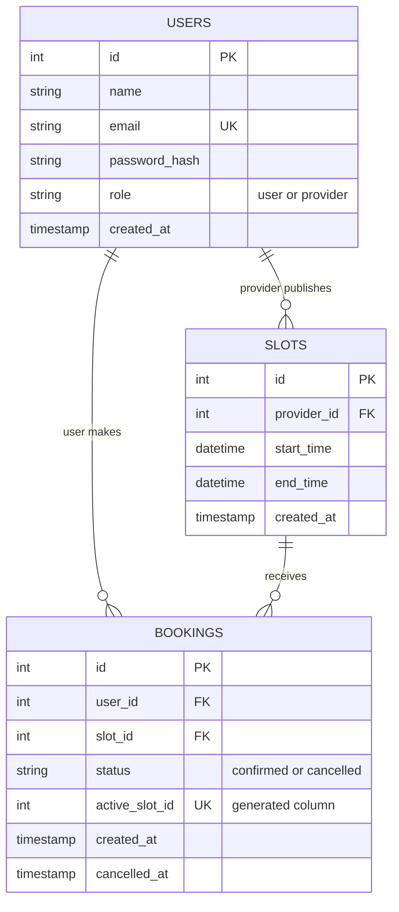

# Appointment Booking API

A REST API for booking appointments. Providers publish time slots, users book them, and the API guarantees that two users can never hold the same slot, even when their requests arrive at the same instant.

Built as the SapphireIQ backend student project (5 modules, 2 weeks) with Node.js, Express, MySQL, JWT, Zod, Jest and Supertest.

## Table of Contents

1. [Features](#features)
2. [Tech Stack](#tech-stack)
3. [Project Structure](#project-structure)
4. [How a Request Flows](#how-a-request-flows)
5. [Database Design](#database-design)
6. [Getting Started](#getting-started)
7. [Environment Variables](#environment-variables)
8. [npm Scripts](#npm-scripts)
9. [Seed Data](#seed-data)
10. [Authentication and Roles](#authentication-and-roles)
11. [API Reference](#api-reference)
12. [Business Rules](#business-rules)
13. [How Double Booking Is Prevented](#how-double-booking-is-prevented)
14. [Validation Rules](#validation-rules)
15. [Error Handling](#error-handling)
16. [Testing](#testing)
17. [Trying the API with Postman](#trying-the-api-with-postman)
18. [Design Decisions and Security Notes](#design-decisions-and-security-notes)
19. [Troubleshooting](#troubleshooting)
20. [Known Limitations and Future Work](#known-limitations-and-future-work)
21. [Module Roadmap](#module-roadmap)

## Features

- JWT authentication with two roles: `user` and `provider`
- Password hashing with bcrypt
- Providers create time slots; users browse only unbooked, future slots
- Slot filtering by provider and by date
- Booking and cancellation, with cancelled slots returning to the available list
- Double-booking prevention enforced by the database, safe under simultaneous requests
- Request validation with Zod (bodies, query strings and URL parameters)
- Centralized error handling with one consistent JSON error format
- Automated integration tests (Jest and Supertest) on a separate test database
- A race-condition script that fires simultaneous bookings at a running server

## Tech Stack

| Area           | Technology                                           |
| -------------- | ---------------------------------------------------- |
| Runtime        | Node.js 18+ (ES modules, `"type": "module"`)         |
| Web framework  | Express                                              |
| Database       | MySQL 8+ via `mysql2` (promise API, connection pool) |
| Authentication | `jsonwebtoken`, `bcrypt`                             |
| Validation     | Zod                                                  |
| Configuration  | `dotenv`                                             |
| Testing        | Jest, Supertest, `cross-env`                         |

## Project Structure

```
appointment-booking-api/
├── scripts/
│   └── raceTest.js              Simultaneous-booking demo against a running server
├── src/
│   ├── config/
│   │   ├── db.js                MySQL connection pool (session time zone set to UTC)
│   │   └── env.js               Loads and validates environment variables
│   ├── controllers/
│   │   ├── authController.js    register, login, me
│   │   ├── bookingController.js bookSlot, getMyBookings, cancelMyBooking
│   │   └── slotController.js    addSlot, getAvailableSlots, getMySlots
│   ├── db/
│   │   ├── init.js              Creates the database and tables
│   │   ├── schema.sql           Table definitions and indexes
│   │   └── seed.js              Sample providers, user and slots
│   ├── middleware/
│   │   ├── authMiddleware.js    Verifies the JWT
│   │   ├── errorHandler.js      Not-found handler and central error handler
│   │   ├── roleMiddleware.js    Role guard
│   │   └── validate.js          Runs Zod schemas on body, query and params
│   ├── models/
│   │   ├── bookingModel.js      SQL for bookings
│   │   ├── slotModel.js         SQL for slots
│   │   └── userModel.js         SQL for users
│   ├── routes/
│   │   ├── authRoutes.js
│   │   ├── bookingRoutes.js
│   │   └── slotRoutes.js
│   ├── utils/
│   │   ├── AppError.js          Error with an HTTP status code
│   │   └── asyncHandler.js      Forwards async errors to the error handler
│   ├── validators/
│   │   ├── authValidator.js
│   │   ├── bookingValidator.js
│   │   └── slotValidator.js
│   ├── app.js                   Express app (exported for tests)
│   └── server.js                Starts the HTTP server
├── tests/
│   ├── auth.test.js
│   ├── bookings.test.js
│   ├── helpers.js
│   └── slots.test.js
├── .env.example
├── .gitignore
├── package.json
└── README.md
```

`app.js` and `server.js` are separate so tests can import the app without opening a network port.

## How a Request Flows

```
Client
  │
  ▼
express.json()                 parses the JSON body
  │
  ▼
Router                         /api/auth, /api/slots, /api/bookings
  │
  ▼
authenticate                   verifies the Bearer token, sets req.user
  │
  ▼
authorizeRoles('...')          checks req.user.role
  │
  ▼
validate({ body, query, params })   Zod; parsed values go to req.validated
  │
  ▼
Controller (asyncHandler)      business rules, throws AppError on failure
  │
  ▼
Model                          parameterized SQL through the connection pool
  │
  ▼
MySQL                          constraints and unique indexes have the final say

Any error thrown anywhere ──► errorHandler ──► one JSON error response
```

The order matters: authentication runs before validation, so an unauthenticated request gets `401` rather than a `400` that reveals the expected request shape.

## Database Design



### Tables

**users**

| Column        | Type                             | Notes                                  |
| ------------- | -------------------------------- | -------------------------------------- |
| id            | INT UNSIGNED, PK, auto increment |                                        |
| name          | VARCHAR(100)                     |                                        |
| email         | VARCHAR(255)                     | Unique index `uq_users_email`          |
| password_hash | VARCHAR(255)                     | bcrypt hash, never returned by the API |
| role          | ENUM('user','provider')          | Default `user`                         |
| created_at    | TIMESTAMP                        | Default current time                   |

**slots**

| Column      | Type                             | Notes                                          |
| ----------- | -------------------------------- | ---------------------------------------------- |
| id          | INT UNSIGNED, PK, auto increment |                                                |
| provider_id | INT UNSIGNED                     | FK to `users.id`, cascades on delete           |
| start_time  | DATETIME                         | Stored in UTC                                  |
| end_time    | DATETIME                         | Stored in UTC, `CHECK (end_time > start_time)` |
| created_at  | TIMESTAMP                        |                                                |

Indexes: `uq_slots_provider_start (provider_id, start_time)` stops a provider creating two slots at the same start time; `idx_slots_start_time (start_time)` speeds up the date-based availability queries.

**bookings**

| Column         | Type                             | Notes                                            |
| -------------- | -------------------------------- | ------------------------------------------------ |
| id             | INT UNSIGNED, PK, auto increment |                                                  |
| user_id        | INT UNSIGNED                     | FK to `users.id`                                 |
| slot_id        | INT UNSIGNED                     | FK to `slots.id`                                 |
| status         | ENUM('confirmed','cancelled')    | Default `confirmed`                              |
| active_slot_id | INT UNSIGNED, generated, stored  | `slot_id` while confirmed, `NULL` once cancelled |
| created_at     | TIMESTAMP                        |                                                  |
| cancelled_at   | TIMESTAMP, nullable              | Set when cancelled                               |

Indexes: `uq_bookings_active_slot (active_slot_id)` is the double-booking guard (see below); `idx_bookings_user (user_id)` speeds up "my bookings".

All times are stored and returned in UTC. The connection pool sets the MySQL session time zone to `+00:00` so `TIMESTAMP` and `DATETIME` columns behave identically.

## Getting Started

### Prerequisites

- Node.js 18 or newer
- MySQL 8 or newer, running locally, with an account that can create databases
- Postman (optional, for manual testing)

### Installation

```bash
git clone https://github.com/98Dinesh89/appointment-booking-api
cd appointment-booking-api
npm install
```

### Configuration

Copy the example file and fill in your MySQL password and a long random secret:

```bash
cp .env.example .env
```

Generate a secure `JWT_SECRET`:

```bash
node -e "import('node:crypto').then(c => console.log(c.randomBytes(32).toString('hex')))"
```

### Create the database and seed it

```bash
npm run db:init
npm run db:seed
```

### Start the server

```bash
npm run dev
```

Check that everything is connected:

```bash
curl http://localhost:5000/api/health
```

Expected: `{"status":"ok","database":"connected"}`

## Environment Variables

| Variable       | Required | Default | Description                                      |
| -------------- | -------- | ------- | ------------------------------------------------ |
| PORT           | No       | 5000    | HTTP port                                        |
| DB_HOST        | Yes      |         | MySQL host                                       |
| DB_PORT        | No       | 3306    | MySQL port                                       |
| DB_USER        | Yes      |         | MySQL user                                       |
| DB_PASSWORD    | No       | empty   | MySQL password                                   |
| DB_NAME        | Yes      |         | Database name, for example `appointment_booking` |
| JWT_SECRET     | Yes      |         | Secret used to sign tokens                       |
| JWT_EXPIRES_IN | No       | 1d      | Token lifetime, for example `1d` or `2h`         |

The server refuses to start if a required variable is missing. Never commit `.env`; it is listed in `.gitignore`.

## npm Scripts

| Script              | What it does                                                  |
| ------------------- | ------------------------------------------------------------- |
| `npm run dev`       | Starts the server and restarts on file changes                |
| `npm start`         | Starts the server                                             |
| `npm run db:init`   | Creates the database and tables (safe to run repeatedly)      |
| `npm run db:seed`   | Wipes users, slots and bookings, then inserts sample data     |
| `npm test`          | Creates the test database if needed, then runs the Jest suite |
| `npm run test:race` | Sends simultaneous booking requests to a running server       |

`db:seed` deletes existing data. Use it on development databases only.

## Seed Data

`npm run db:seed` creates 3 providers, 1 user and 63 slots (3 providers × 7 days × 3 one-hour slots at 09:00, 10:00 and 11:00 UTC, starting tomorrow).

All seeded accounts use the password `Password@123`.

| Role     | Name           | Email                      |
| -------- | -------------- | -------------------------- |
| provider | Dr. Asha Verma | asha.provider@example.com  |
| provider | Rohan Mehta    | rohan.provider@example.com |
| provider | Neha Kapoor    | neha.provider@example.com  |
| user     | Test User      | user@example.com           |

## Authentication and Roles

1. Register or log in to receive a JWT.
2. Send it on every protected request:

```
Authorization: Bearer <token>
```

The token carries the user's `id` and `role` and expires after `JWT_EXPIRES_IN`.

| Capability                         | Public | user | provider |
| ---------------------------------- | ------ | ---- | -------- |
| Health check, register, login      | Yes    | Yes  | Yes      |
| View own profile (`/auth/me`)      | No     | Yes  | Yes      |
| List available slots               | No     | Yes  | Yes      |
| Create slots, list own slots       | No     | No   | Yes      |
| Book, list and cancel own bookings | No     | Yes  | No       |

Authentication failures return `401`. A valid token with the wrong role returns `403`.

## API Reference

Base URL: `http://localhost:5000/api`. Requests and responses are JSON. Send `Content-Type: application/json` on requests with a body.

| Method | Route                  | Access             | Purpose                       |
| ------ | ---------------------- | ------------------ | ----------------------------- |
| GET    | `/health`              | Public             | Server and database check     |
| POST   | `/auth/register`       | Public             | Create an account             |
| POST   | `/auth/login`          | Public             | Log in and receive a token    |
| GET    | `/auth/me`             | Any logged-in user | Current user                  |
| POST   | `/slots`               | Provider           | Create a slot                 |
| GET    | `/slots`               | Any logged-in user | List available future slots   |
| GET    | `/slots/mine`          | Provider           | List the provider's own slots |
| POST   | `/bookings`            | User               | Book a slot                   |
| GET    | `/bookings/mine`       | User               | List the user's bookings      |
| PATCH  | `/bookings/:id/cancel` | User (owner)       | Cancel a booking              |

### GET /health

Response `200`:

```json
{ "status": "ok", "database": "connected" }
```

Returns `500` with `"database": "unreachable"` if MySQL cannot be reached.

### POST /auth/register

Request:

```json
{
  "name": "Alice",
  "email": "alice@example.com",
  "password": "Password@123",
  "role": "user"
}
```

`role` is optional: `user` (default) or `provider`.

Response `201`:

```json
{
  "user": {
    "id": 5,
    "name": "Alice",
    "email": "alice@example.com",
    "role": "user"
  },
  "token": "<jwt>"
}
```

Errors: `400` validation failed, `409` email already registered.

### POST /auth/login

Request:

```json
{ "email": "user@example.com", "password": "Password@123" }
```

Response `200`: same shape as register.

Errors: `400` validation failed, `401` invalid email or password (the same message is used for an unknown email and a wrong password, so the API does not reveal which emails exist).

### GET /auth/me

Response `200`:

```json
{
  "user": {
    "id": 4,
    "name": "Test User",
    "email": "user@example.com",
    "role": "user",
    "created_at": "2026-11-02T10:00:00.000Z"
  }
}
```

Errors: `401`, `404` user no longer exists.

### POST /slots

Provider only. Times are ISO 8601 date-times with a time zone (`Z` or an offset).

Request:

```json
{
  "startTime": "2026-11-20T14:00:00.000Z",
  "endTime": "2026-11-20T15:00:00.000Z"
}
```

Response `201`:

```json
{
  "slot": {
    "id": 64,
    "providerId": 1,
    "startTime": "2026-11-20T14:00:00.000Z",
    "endTime": "2026-11-20T15:00:00.000Z"
  }
}
```

Errors: `400` validation failed (bad dates, end before start, start in the past), `401`, `403` not a provider, `409` this provider already has a slot starting at that time.

### GET /slots

Lists slots that start in the future and have no confirmed booking, earliest first.

| Query parameter | Example      | Meaning                                      |
| --------------- | ------------ | -------------------------------------------- |
| `providerId`    | `1`          | Only this provider's slots                   |
| `date`          | `2026-11-20` | Only slots starting on this UTC calendar day |

Both parameters are optional and can be combined.

Response `200`:

```json
{
  "count": 1,
  "slots": [
    {
      "id": 64,
      "providerId": 1,
      "startTime": "2026-11-20T14:00:00.000Z",
      "endTime": "2026-11-20T15:00:00.000Z",
      "providerName": "Dr. Asha Verma"
    }
  ]
}
```

Errors: `400` invalid `providerId` or `date`, `401`.

### GET /slots/mine

Provider only. Returns every slot the provider has created, booked or not, earliest first.

Response `200`:

```json
{
  "count": 1,
  "slots": [
    {
      "id": 64,
      "providerId": 1,
      "startTime": "2026-11-20T14:00:00.000Z",
      "endTime": "2026-11-20T15:00:00.000Z",
      "isBooked": false
    }
  ]
}
```

Errors: `401`, `403`.

### POST /bookings

User only.

Request:

```json
{ "slotId": 1 }
```

`slotId` must be a number, not a string.

Response `201`:

```json
{
  "booking": {
    "id": 1,
    "userId": 4,
    "slotId": 1,
    "status": "confirmed",
    "createdAt": "2026-11-02T10:00:00.000Z",
    "cancelledAt": null,
    "startTime": "2026-11-03T09:00:00.000Z",
    "endTime": "2026-11-03T10:00:00.000Z",
    "providerId": 1,
    "providerName": "Dr. Asha Verma"
  }
}
```

Errors: `400` invalid `slotId` or the slot has already started, `401`, `403` not a user, `404` slot not found, `409` slot already booked.

### GET /bookings/mine

User only. Returns the user's bookings (confirmed and cancelled), ordered by slot start time.

Response `200`:

```json
{
  "count": 1,
  "bookings": [
    { "id": 1, "status": "confirmed", "...": "same fields as above" }
  ]
}
```

Errors: `401`, `403`.

### PATCH /bookings/:id/cancel

User only, and only for their own bookings. No request body.

Response `200`:

```json
{
  "booking": {
    "id": 1,
    "userId": 4,
    "slotId": 1,
    "status": "cancelled",
    "createdAt": "2026-11-02T10:00:00.000Z",
    "cancelledAt": "2026-11-02T10:05:00.000Z",
    "startTime": "2026-11-03T09:00:00.000Z",
    "endTime": "2026-11-03T10:00:00.000Z",
    "providerId": 1,
    "providerName": "Dr. Asha Verma"
  }
}
```

Errors: `400` invalid id or the slot has already started, `401`, `403` not a user or not the owner, `404` booking not found, `409` already cancelled.

### Example session with curl

These commands use a bash-style shell. On Windows, use Postman or Git Bash.

```bash
# 1. Log in as a user and keep the token
TOKEN=$(curl -s -X POST http://localhost:5000/api/auth/login \
  -H "Content-Type: application/json" \
  -d '{"email":"user@example.com","password":"Password@123"}' \
  | node -pe "JSON.parse(require('fs').readFileSync(0,'utf8')).token")

# 2. See what is available
curl -s http://localhost:5000/api/slots -H "Authorization: Bearer $TOKEN"

# 3. Book slot 1
curl -s -X POST http://localhost:5000/api/bookings \
  -H "Authorization: Bearer $TOKEN" \
  -H "Content-Type: application/json" \
  -d '{"slotId":1}'

# 4. Cancel booking 1
curl -s -X PATCH http://localhost:5000/api/bookings/1/cancel \
  -H "Authorization: Bearer $TOKEN"
```

## Business Rules

**Slots**

- Only providers can create slots.
- A slot must start in the future and end after it starts.
- A provider cannot have two slots with the same start time.
- Milliseconds are dropped; times are stored to the second.

**Availability**

- A slot is listed only if it starts in the future and has no confirmed booking.
- Cancelling a booking makes the slot available again.

**Booking**

- Only users can book.
- The slot must exist, must not have started, and must not already be booked.
- One confirmed booking per slot, at most.

**Cancellation**

- Only the user who made the booking can cancel it.
- A booking cannot be cancelled twice, or after its slot has started.
- Cancelled bookings are kept as history (`status: "cancelled"`), and the slot can be booked again.

## How Double Booking Is Prevented

Checking "is this slot free?" and then inserting a booking is not safe on its own. Two requests can both see the slot as free before either inserts (a race condition). The API protects against this in two layers:

1. **Friendly check.** The controller looks for an existing confirmed booking and returns `409 Slot is already booked` in the normal case.
2. **Database guarantee.** The `bookings` table has a generated column:

   ```sql
   active_slot_id INT UNSIGNED GENERATED ALWAYS AS (IF(status = 'confirmed', slot_id, NULL)) STORED,
   UNIQUE KEY uq_bookings_active_slot (active_slot_id)
   ```

   While a booking is confirmed, `active_slot_id` equals its slot id, so MySQL allows only one such row per slot. When a booking is cancelled, the column becomes `NULL`, and MySQL allows any number of `NULL`s in a unique index, so the slot can be booked again. If two requests race past the friendly check, the second insert fails with `ER_DUP_ENTRY`, and the central error handler converts it into the same `409` response.

You can see this in action with the race script (server running):

```bash
npm run test:race
```

Expected: exactly one `201`, all other requests `409`, and no `500`. You can pass a slot id (`node scripts/raceTest.js 5`) or set `PARALLEL_REQUESTS` to change how many requests are sent. The script cancels the winning booking afterwards so the slot is free again.

## Validation Rules

Validation uses Zod and runs after authentication. Unknown fields in request bodies are ignored.

| Input                     | Rules                                                                        |
| ------------------------- | ---------------------------------------------------------------------------- |
| `name` (register)         | Required, trimmed, 1 to 100 characters                                       |
| `email` (register, login) | Valid email, trimmed, lowercased, at most 255 characters                     |
| `password` (register)     | 8 to 72 characters                                                           |
| `password` (login)        | Required                                                                     |
| `role` (register)         | `user` or `provider`, defaults to `user`                                     |
| `startTime`, `endTime`    | ISO 8601 date-time with time zone; end after start; start in the future      |
| `providerId` (query)      | Positive integer                                                             |
| `date` (query)            | A real calendar date as `YYYY-MM-DD` (for example, `2026-02-31` is rejected) |
| `slotId` (booking body)   | Positive integer (a number, not a string)                                    |
| `:id` (URL)               | Positive integer                                                             |

The 72-character password limit comes from bcrypt.

## Error Handling

All errors pass through one middleware (`src/middleware/errorHandler.js`), so every error response has the same shape.

Standard error:

```json
{ "message": "Slot is already booked" }
```

Validation error:

```json
{
  "message": "Validation failed",
  "errors": [
    { "field": "email", "message": "email must be a valid email address" },
    { "field": "password", "message": "Password must be at least 8 characters" }
  ]
}
```

| Status    | Meaning                                                                                                                                                   |
| --------- | --------------------------------------------------------------------------------------------------------------------------------------------------------- |
| 200 / 201 | Success / resource created                                                                                                                                |
| 400       | Validation failed, malformed JSON body, or the slot has already started                                                                                   |
| 401       | Missing, invalid or expired token; wrong login credentials                                                                                                |
| 403       | Wrong role, or trying to cancel someone else's booking                                                                                                    |
| 404       | Unknown route, slot, booking or user                                                                                                                      |
| 409       | Duplicate email, duplicate slot start time, slot already booked, booking already cancelled                                                                |
| 500       | Unexpected server error. The response is always `{"message":"Internal server error"}`; details are logged on the server only and never sent to the client |

How errors are produced:

- Controllers throw `AppError(statusCode, message)` for expected failures.
- `asyncHandler` forwards thrown and rejected errors to the error handler (no `try/catch` in controllers).
- MySQL duplicate-key errors are mapped to `409` messages by the name of the unique index that was violated.
- Malformed JSON bodies produce `400 Malformed JSON body`.
- Requests to unknown routes produce `404 Route not found`.

## Testing

```bash
npm test
```

What happens:

1. `pretest` creates the `appointment_booking_test` database and its tables (if they do not exist).
2. Jest runs the suites one at a time (`--runInBand`) because they share one database.
3. Tables are emptied before each test.

Tests never touch your development database. The reset helper refuses to run unless the database name ends in `_test`.

| Suite                    | Tests | Covers                                                                                                                                                                                                            |
| ------------------------ | ----- | ----------------------------------------------------------------------------------------------------------------------------------------------------------------------------------------------------------------- |
| `tests/auth.test.js`     | 9     | Registration, duplicate email, validation errors, login success and failure, `/auth/me`                                                                                                                           |
| `tests/slots.test.js`    | 9     | Role guard, slot creation, date validation, duplicate slots, availability list, `providerId` filter, provider's own slots                                                                                         |
| `tests/bookings.test.js` | 12    | Booking, role guard, unknown slot, validation, availability after booking, double booking, simultaneous bookings, cancellation, cancelling twice, cancelling another user's booking, rebooking after cancellation |

Expected output:

```
Test Suites: 3 passed, 3 total
Tests:       30 passed, 30 total
```

Jest prints an "ExperimentalWarning" about VM Modules. This is expected: it is required to run native ES modules and is harmless.

The tests need a `.env` file (database credentials and `JWT_SECRET`), because the test run loads the same configuration and overrides only `DB_NAME`.

## Trying the API with Postman

1. Create an environment called `Booking API` and select it (top right).
2. Add the variables `userToken` and `providerToken`.
3. Create a `POST {{baseUrl}}/auth/login` request (or use the full URL `http://localhost:5000/api/auth/login`) with body **raw → JSON**:

   ```json
   { "email": "user@example.com", "password": "Password@123" }
   ```

4. In its **Scripts → Post-response** tab (**Tests** in older versions), add:

   ```js
   const data = pm.response.json();
   pm.environment.set("userToken", data.token);
   ```

5. Repeat for `asha.provider@example.com`, saving to `providerToken`.
6. On any protected request, open **Authorization**, choose **Bearer Token**, and enter `{{userToken}}` or `{{providerToken}}`.

Do not type the word `Bearer` into the token field; Postman adds it.

## Design Decisions and Security Notes

- **Layered structure.** Routes only wire middleware, controllers hold business rules, and models hold SQL, so each layer can be changed or tested on its own.
- **Parameterized queries.** All SQL uses `?` placeholders, which prevents SQL injection.
- **Passwords.** Hashed with bcrypt (cost 10); hashes are never returned by any endpoint.
- **Generic login errors.** An unknown email and a wrong password produce the same `401`, so the API does not reveal which emails are registered.
- **Role whitelist.** Registration accepts only `user` or `provider`; unknown body fields are discarded, so a client cannot invent roles or fields.
- **Secrets.** `JWT_SECRET` and database credentials come from environment variables, and the server will not start without them.
- **Hidden internals.** Unexpected errors return a generic `500`; stack traces stay in the server log.
- **UTC everywhere.** Times are stored, queried and returned in UTC, and the MySQL session is pinned to UTC, so results do not depend on the server's time zone.
- **Database as the final authority.** Uniqueness (email, provider start time, active booking per slot) is enforced by indexes, not only by application code.
- **Safe test setup.** The test database is separate, and the reset helper checks the database name before deleting anything.

## Troubleshooting

| Problem                                                           | Likely cause and fix                                                                                                          |
| ----------------------------------------------------------------- | ----------------------------------------------------------------------------------------------------------------------------- |
| `Missing environment variables: ...`                              | `.env` is missing or incomplete. Copy `.env.example` and fill it in.                                                          |
| `ECONNREFUSED`                                                    | MySQL is not running, or `DB_HOST` / `DB_PORT` is wrong.                                                                      |
| `Access denied for user`                                          | Wrong `DB_USER` or `DB_PASSWORD`.                                                                                             |
| `Unknown database`                                                | Run `npm run db:init`.                                                                                                        |
| `/api/health` says `unreachable`                                  | Check the MySQL service and the `.env` values, then restart the server.                                                       |
| `401 Invalid or expired token`                                    | Log in again. Changing `JWT_SECRET` invalidates all existing tokens.                                                          |
| `401 Authentication token missing` (Postman)                      | Auth type is not Bearer Token, or `{{userToken}}` is empty or red (no environment selected).                                  |
| `400` on valid-looking data (Postman)                             | Body is not set to raw and JSON.                                                                                              |
| `bcrypt` fails to install                                         | Install build tools for your OS, or switch to `bcryptjs` (same API; change the imports in `seed.js` and `authController.js`). |
| `npm test` cannot create the test database                        | The MySQL user needs permission to create databases.                                                                          |
| `Refusing to reset a database whose name does not end with _test` | Run tests through `npm test`, which sets `DB_NAME` correctly.                                                                 |
| `test:race` shows `500` responses                                 | The server is running an old version of the booking code. Pull the latest, restart, and run it again.                         |

## Known Limitations and Future Work

- **No overlap detection.** A provider can create overlapping slots with different start times. Only identical start times are rejected.
- **No pagination.** `GET /slots` and `GET /bookings/mine` return all matching rows.
- **Stateless tokens.** There is no logout, token revocation or refresh token; a token is valid until it expires.
- **No rate limiting or security headers.** Adding `express-rate-limit` and `helmet` is the usual next step for deployment.
- **No provider view of bookings.** Providers can see which slots are booked but not who booked them.
- **No rescheduling, reminders or notifications.**
- **Schema changes are manual.** `schema.sql` uses `CREATE TABLE IF NOT EXISTS`; a migration tool would be needed to evolve an existing database.
- **Possible additions:** interactive API docs (OpenAPI / Swagger), a CI workflow that runs `npm test`, and Docker Compose for Node and MySQL.

## Module Roadmap

How this project maps to the five modules of the SapphireIQ guide:

| Module | Topic                              | Where it lives                                                                                    |
| ------ | ---------------------------------- | ------------------------------------------------------------------------------------------------- |
| 1      | Setup and data modeling            | `src/config`, `src/db`, `src/app.js`, `src/server.js`                                             |
| 2      | Authentication and roles           | `authController.js`, `authMiddleware.js`, `roleMiddleware.js`, `authRoutes.js`                    |
| 3      | Slots and booking endpoints        | `slotController.js`, `bookingController.js`, `src/models`, `slotRoutes.js`, `bookingRoutes.js`    |
| 4      | Conflict prevention and validation | `uq_bookings_active_slot` in `schema.sql`, `src/validators`, `validate.js`, `scripts/raceTest.js` |
| 5      | Error handling and testing         | `errorHandler.js`, `AppError.js`, `asyncHandler.js`, `tests/`, this README                        |

## Author

Dinesh Sunda
